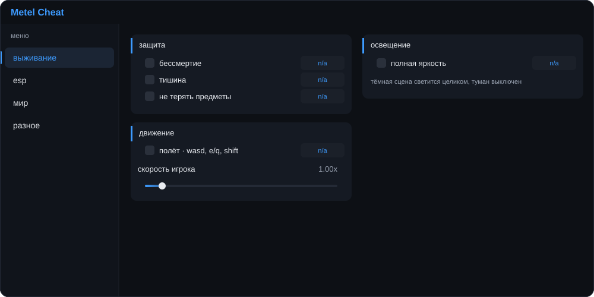

# metel cheat

мод-меню для **metel horror escape** на пк. основные функции собраны в четырёх вкладках, клавиши можно назначить в самой игре.



## возможности

| вкладка | функции |
| --- | --- |
| выживание | бессмертие, тишина, сохранение предметов, полёт, скорость и яркость |
| esp | метки маньяка, предметов и ключей |
| мир | заморозка маньяка, анти-капкан, автосбор предметов |
| разное | открытие уровней и настройка горячих клавиш |

## управление

- `f1` открывает меню, пока для него не назначена другая клавиша.
- клавиши настраиваются во вкладке «разное»; `delete` снимает назначение.
- в режиме полёта используются `wasd`, `e`, `q` и `shift`.

## установка

мод рассчитан на пк-версию игры и melonloader 0.7.3. если melonloader уже установлен, помести `MetelCheat.dll` в папку `Mods` игры.

## сборка

проект использует `.net framework 4.7.2`. перед сборкой укажи в `mod/MetelCheat.csproj` локальные пути к игре и библиотекам melonloader, затем выполни из корня проекта:

```powershell
dotnet build mod/MetelCheat.csproj -c Release
```

собранный файл появится в `mod/bin/Release/MetelCheat.dll`.

## файлы проекта

- `mod/` — исходный код мода и проект сборки.
- `assets/metel-cheat-ui.svg` — векторный макет меню.
